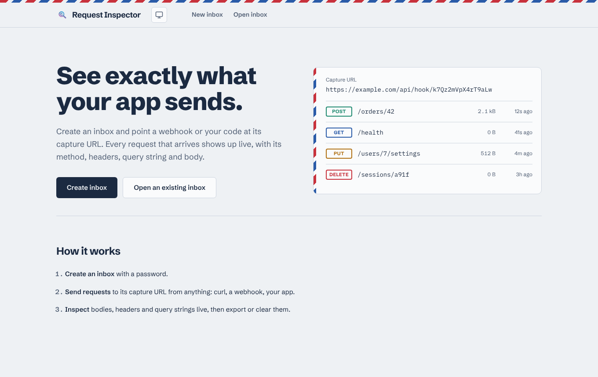
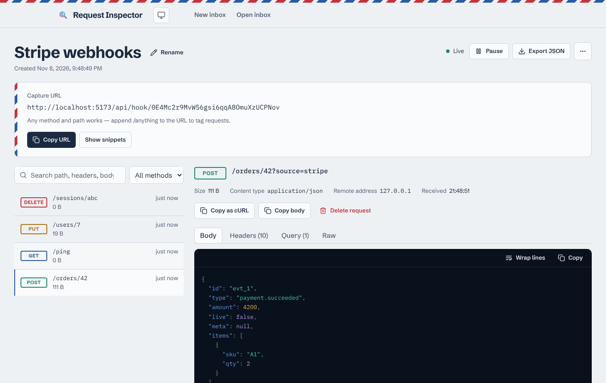
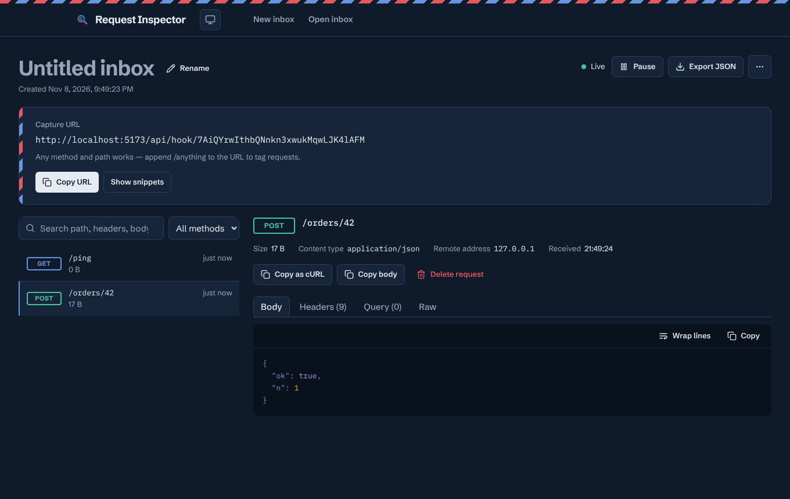
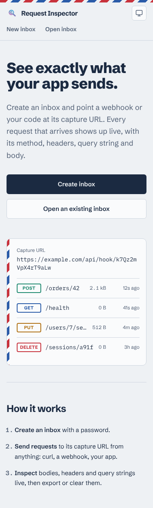

# Request Inspector


Catch and inspect HTTP requests in a private inbox. Create an inbox, point a webhook, a script or your app at its
**capture URL**, and watch every request arrive live with its method, path, headers, query string and body.

Built with FastAPI and Vue 3 + Vite.

<p>
  <a href="screenshots/home.png"></a>
  <a href="screenshots/inbox.png"></a>
  <a href="screenshots/inbox-dark.png"></a>
  <a href="screenshots/mobile.png"></a>
</p>

## Features

- Capture **any method** (GET, POST, PUT, PATCH, DELETE, OPTIONS, HEAD) and any content type, on the capture URL or any sub-path below it (`/api/hook/<key>/orders/42`)
- Live updates over WebSocket, with pause/resume and automatic reconnect
- Request detail: pretty-printed JSON, form bodies, binary bodies (base64), headers, query string, and the raw HTTP message
- Search across path, headers and body; filter by method; paginate older requests
- Copy any captured request as a cURL command; ready-made send snippets for curl, fetch, Python and HTTPie
- Export an inbox as JSON, delete single requests, clear all, rename the inbox
- Rotate the capture URL if it leaks; delete the inbox entirely
- Password-protected inboxes; recently opened inboxes remembered locally
- Light, dark and system themes; works on phones

## Getting started

Requires Node.js 20+ and Python 3.11+.

```bash
git clone https://github.com/Faikuu/request_inspector.git
```

```bash
cd request_inspector && npm run setup
```

```bash
npm start
```

Open http://localhost:5173. The backend runs on port 8000 and uses a local SQLite file by default.

Other scripts: `npm test` runs the backend test suite and the frontend type-check, and `npm run build` builds the frontend into `frontend/dist`.

### Configuration

The backend reads `RI_*` environment variables (or `backend/.env`). See [`backend/.env.example`](backend/.env.example) for all options. The important ones:

| Variable | Default | Purpose |
|---|---|---|
| `RI_SECRET_KEY` | random per start | Signs viewer tokens. **Set this in production**, otherwise sessions end on every restart. |
| `RI_DATABASE_URL` | `sqlite+aiosqlite:///./request_inspector.db` | Use `postgresql+asyncpg://…` for PostgreSQL (`docker compose up db` starts one). |
| `RI_CORS_ORIGINS` | `http://localhost:5173,…` | Origins allowed to call the viewer API and open the live stream. |
| `RI_MAX_BODY_BYTES` | `1048576` | Larger captured bodies are rejected with 413. |
| `RI_MAX_REQUESTS_PER_INBOX` | `500` | Oldest requests are pruned past this. |
| `RI_TRUST_PROXY_HEADERS` | `false` | Use `X-Forwarded-For` for client IPs. Turn on only behind a trusted reverse proxy. |

## How it works

| Endpoint | Purpose |
|---|---|
| `POST /api/inboxes` | Create an inbox (password ≥ 8 characters) and get a viewer token |
| `POST /api/inboxes/{id}/session` | Exchange the password for a viewer token (rate limited) |
| `GET/PATCH/DELETE /api/inboxes/{id}` | Read, rename or delete an inbox |
| `POST /api/inboxes/{id}/rotate-key` | Issue a new capture URL |
| `GET/DELETE /api/inboxes/{id}/requests[/{rid}]` | List (search, filter, paginate), read, delete or clear requests |
| `GET /api/inboxes/{id}/export` | Download all requests as JSON |
| `ANY /api/hook/{ingest_key}[/{path}]` | The capture URL: no auth, the key is the secret |
| `WS /api/inboxes/{id}/stream` | Live events; authenticate by sending `{"type":"auth","token":"…"}` first |

## Security model

- The capture URL contains a random ingest key that can **only write** to the inbox. Reading requires the password.
- Passwords are hashed with Argon2. Login attempts are rate limited per client and per inbox, and an unknown inbox ID is indistinguishable from a wrong password.
- Viewer tokens are short-lived JWTs scoped to one inbox. They're kept in the tab's `sessionStorage`, so they're never sent as cookies. The WebSocket receives the token as its first message rather than in the URL.
- Captured data is treated as untrusted: it's rendered as text, never as HTML.
- Bodies are size-limited, inboxes are capped, the WebSocket checks `Origin`, CORS is limited to configured origins (except the capture URL), and API responses carry `nosniff`, `frame-ancestors 'none'` and a restrictive CSP. API docs are off unless `RI_ENABLE_DOCS=true`.
- Rate limits and live broadcasts are in-process: run a single backend worker, or put shared state (e.g. Redis) behind them before scaling out.

## Project structure

```
backend/
  app/            FastAPI app: config, db, models, schemas, security, rate limiting, realtime hub
  app/routers/    inboxes, hooks (capture), stream (WebSocket)
  tests/          pytest suite
frontend/
  src/api/        typed API client and wire types
  src/views/      Home, Create inbox, Open inbox, Inbox, Not found
  src/components/ app shell, inbox workspace (list, detail, code block, snippets…), ui primitives
  src/lib/        formatting, JSON tokenizer, snippets, session/recent storage
```
